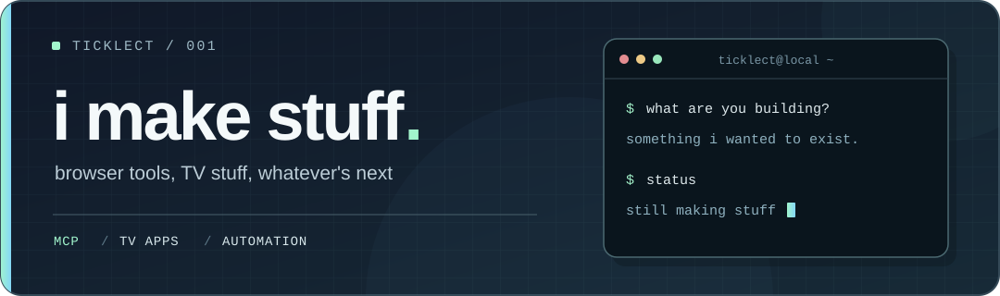

  <picture>
    <source media="(prefers-color-scheme: dark)" srcset="./assets/hero-dark.svg">
    <source media="(prefers-color-scheme: light)" srcset="./assets/hero-light.svg">
    
  </picture>

I build things I wish already existed. Mostly browser tools and TV stuff.

### stuff i've made

<table>
  <tr>
    <td width="50%" valign="top">
      <a href="https://github.com/Ticklect/Easy-Social-MCPs"><b>Easy Social MCPs ↗</b></a>
        
      MCP tools for Reddit, X, TikTok and YouTube. Log in through your browser and use them from your MCP client.
    </td>
    <td width="50%" valign="top">
      <a href="https://github.com/Ticklect/tvdoctor"><b>TVDoctor ↗</b></a>
        
      Tests TV apps with a remote's D-pad. Catches broken navigation, focus getting stuck and buttons that don't work.
    </td>
  </tr>
  <tr>
    <td colspan="2" valign="top">
      <a href="https://github.com/Ticklect/youtube-downloader"><b>YouTube Downloader ↗</b></a>
        
      A Chrome/Firefox extension and Windows helper. Pick videos from a channel and save video, MP3s or captions to your PC.
    </td>
  </tr>
</table>
