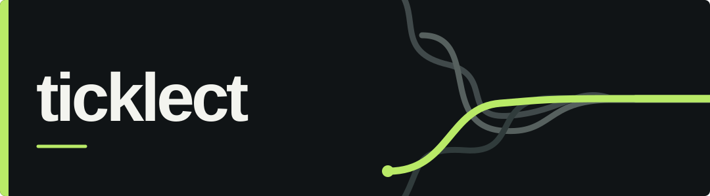

<picture>
  <source media="(prefers-color-scheme: dark)" srcset="./assets/banner-dark.svg">
  <source media="(prefers-color-scheme: light)" srcset="./assets/banner-light.svg">
  
</picture>

I like making things easier. Most of my projects start because something takes too long, has too many steps, or just gets on my nerves.

### stuff i've made

**[Easy Social MCPs](https://github.com/Ticklect/Easy-Social-MCPs)** — Use Reddit, X, TikTok and YouTube from an MCP client without setting up developer API keys.

**[TVDoctor](https://github.com/Ticklect/tvdoctor)** — Tests TV apps using D-pad controls and finds places where the navigation gets stuck.

**[YouTube Downloader](https://github.com/Ticklect/youtube-downloader)** — Pick videos from a channel and save the video, audio or captions to your PC.
